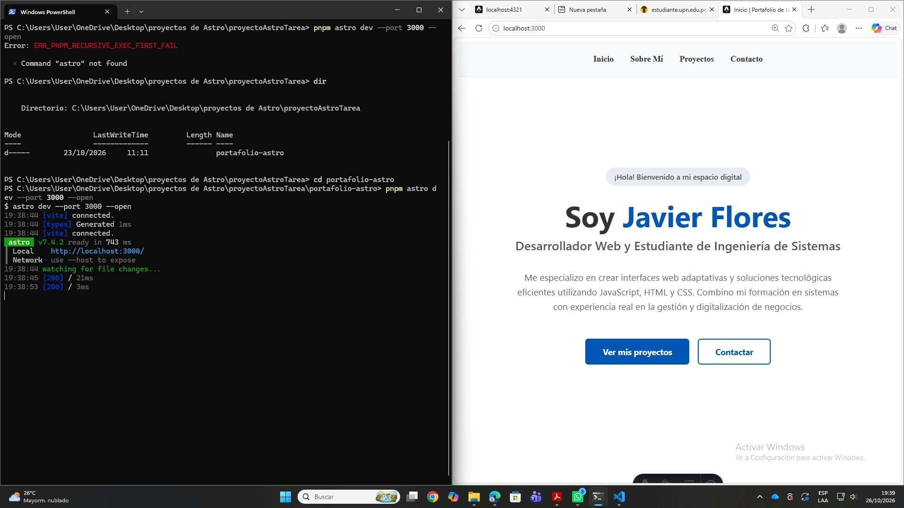
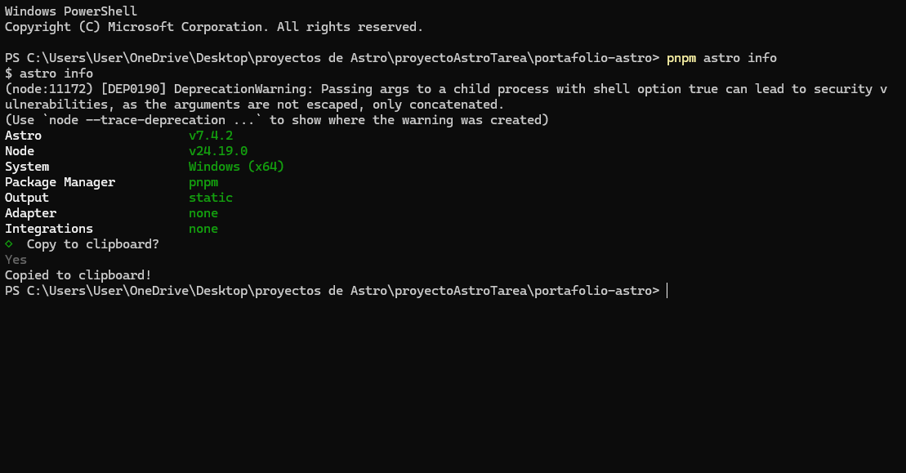
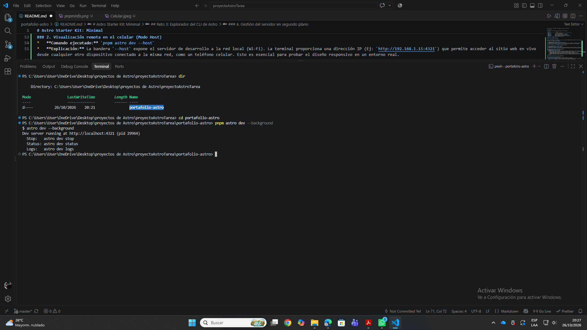
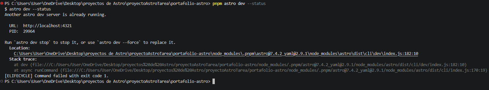
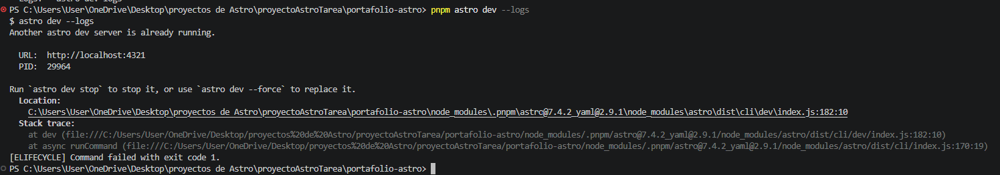
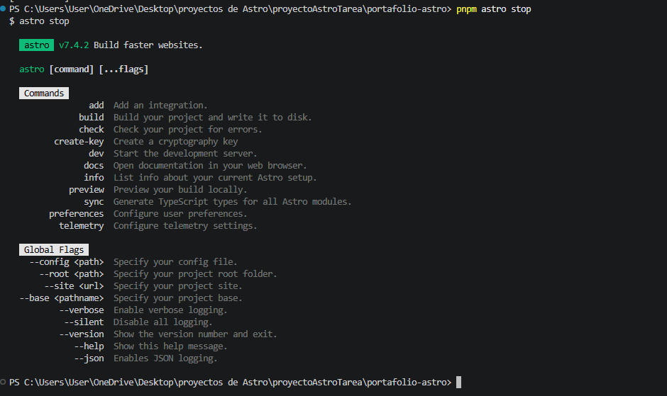
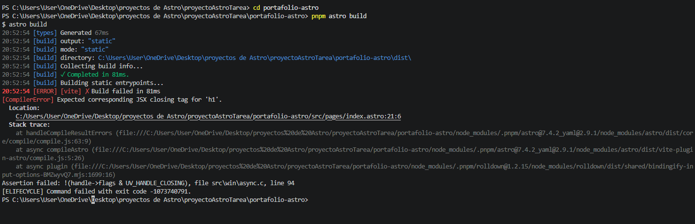
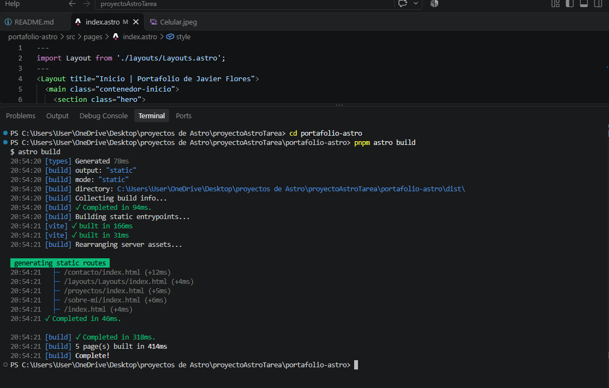

# Astro Starter Kit: Minimal

```sh
pnpm create astro@latest -- --template minimal
```

> 🧑‍🚀 **Seasoned astronaut?** Delete this file. Have fun!

## 🚀 Project Structure

Inside of your Astro project, you'll see the following folders and files:

```text
/
├── public/
├── src/
│   └── pages/
│       └── index.astro
└── package.json
```

Astro looks for `.astro` or `.md` files in the `src/pages/` directory. Each page is exposed as a route based on its file name.

There's nothing special about `src/components/`, but that's where we like to put any Astro/React/Vue/Svelte/Preact components.

Any static assets, like images, can be placed in the `public/` directory.

## 🧞 Commands

All commands are run from the root of the project, from a terminal:

| Command                | Action                                           |
| :--------------------- | :----------------------------------------------- |
| `pnpm install`         | Installs dependencies                            |
| `pnpm dev`             | Starts local dev server at `localhost:4321`      |
| `pnpm build`           | Build your production site to `./dist/`          |
| `pnpm preview`         | Preview your build locally, before deploying     |
| `pnpm astro ...`       | Run CLI commands like `astro add`, `astro check` |
| `pnpm astro -- --help` | Get help using the Astro CLI                     |

## Guía del CLI (Comandos de Astro)

## Reto 3: Explorador del CLI de Astro

En esta sección documento la exploración y el uso de los comandos fundamentales de la interfaz de línea de comandos (CLI) de Astro, utilizando `pnpm` como gestor de paquetes. A continuación, presento la ejecución paso a paso de los requisitos solicitados:

### 1. Cambio de puerto y apertura automática

- **Comando ejecutado:** `pnpm astro dev --port 3000 --open`
- **Explicación:** Este comando inicia el servidor local de desarrollo. La bandera `--port 3000` cambia el puerto predeterminado (4321) al puerto 3000. Por su parte, la bandera `--open` ordena al sistema abrir automáticamente una pestaña en el navegador web predeterminado una vez que el servidor se ha inicializado.



### 2. Visualización remota en el celular (Modo Host)

- **Comando ejecutado:** `pnpm astro dev --host`
- **Explicación:** La bandera `--host` expone el servidor de desarrollo a la red local (Wi-Fi). La terminal proporciona una dirección IP (Ej: `http://192.168.1.15:4321`) que permite acceder al sitio web en vivo desde cualquier otro dispositivo conectado a la misma red, como un teléfono celular. Esto es esencial para probar el diseño responsivo en un entorno real.


### 3. Diagnóstico del entorno (`astro info`)

- **Comando ejecutado:** `pnpm astro info`
- **Explicación del reporte:** Al ejecutar este comando, obtenemos un informe técnico de nuestro entorno de desarrollo:
  - **Astro (v7.4.2) / Node (v24.19.0):** Confirma las versiones exactas del framework y de su motor de ejecución (Node.js).
  - **System (Windows x64):** Muestra el sistema operativo donde se compila el código.
  - **Package Manager (pnpm):** Reafirma que utilizamos `pnpm` para gestionar nuestras dependencias.
  - **Output (static):** Indica que nuestro proyecto utilizará por defecto la Generación de Sitios Estáticos (SSG), pre-construyendo el HTML para mayor velocidad.
  - **Adapter e Integrations (none):** Muestra que, al partir de un proyecto minimalista, aún no se han instalado adaptadores de servidor (para SSR) ni integraciones adicionales de terceros (como Tailwind o React).



### 4. Gestión del servidor en segundo plano

Se probó la secuencia de comandos para controlar procesos invisibles en la terminal:

- `pnpm astro dev --background`: nicia el servidor de desarrollo en segundo plano. La terminal no se bloquea y queda inmediatamente disponible para nuevas instrucciones, mientras el servidor aloja el sitio en localhost:4321.
  
- `pnpm astro status`: Consulta el sistema para confirmar si existe un servidor de Astro ejecutándose oculto. Es útil para verificar el estado del puerto antes de iniciar nuevos procesos.
  
- `pnpm astro logs`: Funciona como el visor del historial o "caja negra" del servidor oculto. Al no poder ver la terminal del servidor en vivo, este comando imprime todos los mensajes, advertencias y errores que el servidor en background ha estado generando mientras trabajábamos.
  
- `pnpm astro stop`: Actúa como el botón de apagado de emergencia. Detiene y apaga de forma segura el proceso del servidor oculto, liberando el puerto y limpiando el entorno para futuras ejecuciones.
  

### 5. Simulación y corrección de un error de compilación (Build)

- **Comando ejecutado:** `pnpm astro build`
- **Explicación:** El proceso de `build` genera la versión final estática del sitio y exige una sintaxis perfecta. Para probar esto, se provocó un error tipográfico intencional (dejando una etiqueta HTML abierta). La terminal detuvo el proceso y arrojó un error. Tras corregir la etiqueta en el código fuente, se volvió a ejecutar el comando y el proyecto compiló exitosamente, demostrando la rigurosidad de la herramienta.




## 👀 Want to learn more?

Feel free to check [our documentation](https://docs.astro.build) or jump into our [Discord server](https://astro.build/chat).
